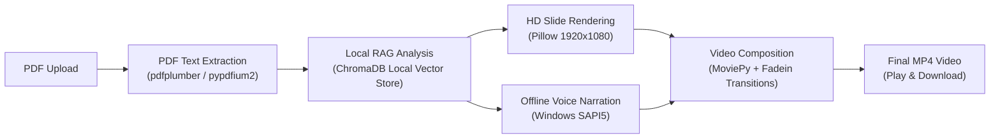

# 🎬 PDF to Explainer Video Converter (DocuVideo RAG)

> **College Minor Project**: Ingests any user-uploaded PDF document, extracts key concepts using **Local Retrieval-Augmented Generation (RAG)**, and compiles an MP4 explainer video with **high-definition visual slides, smooth transitions, and synchronized voiceover narration**—**100% offline, without external AI APIs**.

---

## 🏗️ System Pipeline



---

## ✨ Features

- **Upload & Convert:** Simply upload a PDF, choose slide count (3–6), and click **"Generate Explainer Video"**.
- **Visual Presentation Slides:** 1920x1080 Full HD slides with card layouts, highlighted bullet points, key takeaways, and source citations.
- **Synchronized Audio Tracks:** Native offline voiceover narration matching slide duration dynamically.
- **Smooth Visual Transitions:** Clean crossfade and fade-in transitions between sections.
- **Zero Cloud AI Integration:** 100% offline execution—no OpenAI, Gemini, or Claude API keys needed.

---

## ⚙️ Environment Setup & Configuration

### 1. Clone & Install Dependencies
Using standard Python `pip`:
```powershell
pip install -r requirements.txt
```
Or using Conda (`environment.yml`):
```powershell
conda env create -f environment.yml
conda activate docuvideo-rag
```

### 2. Configure Environment Variables
Copy the provided environment template `.env.example` to create your local `.env` file:
```powershell
# On Windows (PowerShell):
Copy-Item .env.example .env

# On Linux/macOS:
cp .env.example .env
```
Customize parameters inside `.env` if desired (such as `STREAMLIT_SERVER_PORT`, `VIDEO_FPS`, `RAG_CHUNK_SIZE`, or `TTS_VOICE_INDEX`).

---

## 🚀 How to Run

### 1. Launch the Web Interface (Streamlit)
```powershell
streamlit run app.py
```
- Open `http://localhost:8501` in your browser.
- Upload any PDF (or click **"Use Sample PDF"**).
- Click **"🚀 Generate Explainer Video"** to watch the video in-browser and download the MP4.

### 2. Run via Command Line (CLI)
```powershell
python cli.py --pdf sample_documents/sample_research_paper.pdf --slides 4 --output output/videos/my_video.mp4
```

---

## 📂 Project Structure

```
College Assistant/
├── app.py                      # Clean Streamlit Web Application
├── cli.py                      # Command-Line Interface tool
├── requirements.txt            # Python dependencies (pip)
├── environment.yml             # Conda environment definition
├── .env.example                # Template configuration file for GitHub
├── .env                        # Local environment variables (ignored by Git)
├── .gitignore                  # Git ignore rules
├── README.md                   # Setup and usage guide
├── PROJECT_REPORT.md           # Formal Academic Project Report & Viva Voce Q&A
│
├── core/                       # Core Processing Engine
│   ├── __init__.py             # Package exports
│   ├── pdf_extractor.py        # Clean PDF text and metadata extraction
│   ├── rag_engine.py           # Local RAG chunking, indexing, and slide synthesis
│   ├── slide_generator.py      # Pillow 1080p HD slide graphics renderer
│   ├── audio_generator.py      # Thread-safe Windows SAPI voice synthesizer
│   └── video_composer.py       # MoviePy audio-visual synchronization & MP4 composer
│
├── sample_documents/           # Sample test documents
│   ├── sample_research_paper.pdf
│   └── test_docuvideo_paper.pdf
└── output/                     # Generated slides, audios, and MP4 videos (ignored by Git)
```
